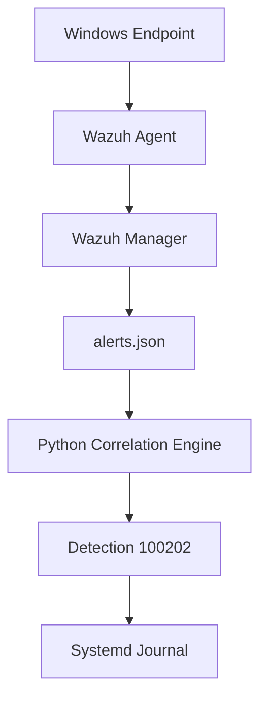

# Wazuh SIEM – Custom Alert Correlation

A Python-based security monitoring project that extends Wazuh SIEM with custom alert correlation logic, real-time log monitoring, and a hardened systemd service.

## Overview

This project detects suspicious Windows login activity by correlating brute-force alerts with subsequent successful authentication events.

The goal is to identify potentially compromised accounts and demonstrate practical skills in SIEM monitoring, log analysis, Python programming, Linux security hardening, and detection engineering.

## System Architecture



The correlation engine runs as a dedicated, non-root systemd service and reads Wazuh alerts without modifying the original log files.

## Detection Logic

The correlation engine monitors the following alerts:

| Rule ID | Description |
|---|---|
| 100201 | Custom brute-force detection |
| 60118 | Successful Windows interactive login |
| 100202 | Python-generated correlation detection |

A detection is generated when:

1. A brute-force alert is detected.
2. A successful login occurs within 60 seconds.
3. Both events belong to the same Wazuh agent and username.

The resulting detection indicates suspicious authentication activity, not confirmed account compromise.

Rule 100202 is currently generated by the Python engine and is not yet integrated into the Wazuh dashboard.

## Features

- Real-time monitoring of Wazuh JSON alerts
- Custom Python correlation engine
- 60-second correlation window
- Agent and username matching
- Duplicate detection suppression
- Automatic removal of expired alerts
- Handling of incomplete JSON log lines
- Detailed JSON parsing error reporting
- Inode-based log rotation detection
- Graceful shutdown handling
- Automated correlation tests
- Hardened systemd background service
- Automatic startup on system boot
- Detection logging through the systemd journal

## Project Structure

```text
wazuh-siem-correlation/
├── systemd/
│   ├── wazuh-correlation.service
│   └── hardening.conf
├── correlate_logins.py
├── watch_alerts.py
├── test_correlation.py
├── .gitignore
└── README.md
```

## Technologies

- Python 3
- Wazuh SIEM
- Linux
- Systemd
- Windows Security Event Logs
- JSON
- Git and GitHub

## Prerequisites

- Linux system with systemd
- Python 3
- Running Wazuh Manager
- Configured Windows Wazuh agent
- Custom Wazuh brute-force rule 100201
- Access to /var/ossec/logs/alerts/alerts.json
- Administrative privileges for service installation

The custom Wazuh rule must be configured separately.
It is not currently included in this repository.

## Installation

### 1. Clone the repository

```bash
git clone https://github.com/eduzerozero/wazuh-siem-correlation.git
cd wazuh-siem-correlation
```

### 2. Run the automated tests

```bash
python3 test_correlation.py
```

### 3. Create a dedicated service user

```bash
sudo useradd --system --user-group --no-create-home \
    --shell /usr/sbin/nologin wazuh-correlation
```

Skip this step if the service user already exists.

### 4. Install the Python files

```bash
sudo install -d -o root -g wazuh-correlation -m 750 \
    /opt/wazuh-correlation

sudo install -o root -g wazuh-correlation -m 640 \
    watch_alerts.py \
    correlate_logins.py \
    /opt/wazuh-correlation/
```

### 5. Install the systemd service

```bash
sudo install -m 644 systemd/wazuh-correlation.service \
    /etc/systemd/system/wazuh-correlation.service

sudo mkdir -p \
    /etc/systemd/system/wazuh-correlation.service.d

sudo install -m 644 systemd/hardening.conf \
    /etc/systemd/system/wazuh-correlation.service.d/hardening.conf
```

### 6. Verify and start the service

```bash
sudo systemd-analyze verify \
    /etc/systemd/system/wazuh-correlation.service

sudo systemctl daemon-reload
sudo systemctl enable --now wazuh-correlation.service
```

### 7. Verify the service status

```bash
sudo systemctl status wazuh-correlation.service --no-pager
```

### 8. Monitor live detections

```bash
sudo journalctl -u wazuh-correlation.service -n 0 -f
```

## Security Hardening

The service follows the principle of least privilege and uses multiple systemd security mechanisms.

| Security Mechanism | Purpose |
|---|---|
| Dedicated non-root user | Reduces process privileges |
| NoNewPrivileges | Prevents acquisition of additional privileges |
| CapabilityBoundingSet | Removes Linux capabilities |
| ProtectSystem | Restricts filesystem write access |
| ProtectHome | Restricts access to home directories |
| PrivateTmp | Isolates temporary files |
| PrivateDevices | Restricts hardware device access |
| PrivateNetwork | Isolates the service from the host network |
| ProtectKernelLogs | Restricts kernel log access |
| ProtectKernelModules | Protects kernel modules |
| ProtectKernelTunables | Protects kernel configuration |
| ProtectControlGroups | Protects control group configuration |
| RestrictNamespaces | Prevents namespace creation |
| RestrictAddressFamilies | Restricts socket address families |
| MemoryDenyWriteExecute | Restricts writable executable memory |
| ProtectProc | Restricts process visibility |
| UMask | Restricts permissions on newly created files |

The service receives supplementary access through the Wazuh group to read the required alert logs.

This group may grant access to additional Wazuh files. More granular file access restrictions are a potential future improvement.

## Security Benchmark

The service was evaluated using:

```bash
sudo systemd-analyze security wazuh-correlation.service
```

| Metric | Before Hardening | After Hardening |
|---|---|---|
| Exposure Score | 5.0 | 2.1 |
| Security Rating | MEDIUM | OK |

The additional hardening reduced the systemd exposure score by 58%.

This score represents the security mechanisms evaluated by systemd and is not a direct measurement of attack probability or overall system security.

## Testing

### Automated Correlation Tests

All eight correlation tests passed successfully.

The tests cover:

- Different usernames
- Different Wazuh agents
- Valid correlation at 30 seconds
- Valid correlation at 60 seconds
- Invalid correlation at 61 seconds
- Invalid correlation at 120 seconds
- Duplicate detection suppression
- Removal of expired alerts

### Manual Log Handling Tests

| Test | Result |
|---|---|
| Incomplete JSON log lines | Passed |
| Log file replacement | Passed |
| Reading alerts after log rotation | Passed |
| Service startup | Passed |
| Alert processing after hardening | Passed |

### Live Detection Test

A controlled authentication test was performed against a dedicated Windows test account.

```text
Neuer Alert | Rule: 100201 | Agent: 002
Neuer Alert | Rule: 60118 | Agent: 002
DETECTION 100202 | Agent: 002 | User: wazuh-test | Zeitdifferenz: 38.36s
```

| Metric | Result |
|---|---|
| Brute-force detection | Successful |
| Successful login detection | Successful |
| Alert correlation | Successful |
| Correlation time difference | 38.36 seconds |
| Maximum correlation window | 60 seconds |
| JSON parsing errors during test | None observed |

The complete correlation was verified before the additional systemd hardening.

After hardening, service startup and successful login alert processing were verified again.

### Service Performance

Observed values after applying the additional hardening:

| Metric | Result |
|---|---|
| Memory usage | 6.1 MB |
| Automatic service restarts | 0 |
| Service status | Active |
| Automatic startup configuration | Enabled |

These values represent observations from the homelab test environment, not long-term performance benchmarks.

## Known Limitations

- Correlation results are currently stored in the systemd journal.
- Detection results are not yet integrated into the Wazuh dashboard.
- Correlation state is stored in memory and is lost when the service restarts.
- Existing alerts are skipped when the monitoring service starts.
- Inode-based log rotation is supported, but file truncation and additional rotation edge cases require further testing.
- The custom Wazuh brute-force rule must be configured separately.
- The service has not undergone production-scale testing.

## Current Status

**Development / Homelab Project**

The correlation engine, real-time monitoring, systemd integration, automatic startup configuration, and additional security hardening have been implemented successfully.

The project has been validated through automated correlation tests, manual log handling tests, and controlled Windows authentication events.

## Future Improvements

- Structured JSON detection logging
- Integration with the Wazuh dashboard
- MITRE ATT&CK mapping
- Include custom Wazuh rule configuration
- Improve log rotation and truncation handling
- Persistent correlation state
- More granular filesystem access restrictions
- Expand automated tests
- GitHub Actions for continuous integration
- Automated incident response

## Disclaimer

This project was developed for educational purposes in a controlled cybersecurity homelab environment.

All authentication tests were performed against authorized systems and dedicated test accounts.

This project is not intended to replace production-grade SIEM detection mechanisms.

## SIEM Integration Update – 2026-11-25

### Implemented Features

- Structured JSON detection logging
- Native Wazuh alert integration
- Custom Wazuh rule 100202 with alert level 12
- MITRE ATT&CK mapping: T1110 (Brute Force)
- Restricted systemd write permissions
- Detection indexing and dashboard search

### Validation Results

| Test | Result |
|---|---|
| Automated correlation tests | 8/8 passed |
| Python syntax validation | Passed |
| Structured JSON logging | Passed |
| Wazuh custom rule matching | Passed |
| MITRE ATT&CK mapping | Passed |
| Detection indexing | Passed |
| Dashboard alert search | Passed |

### Pending Tasks

- Update the complete installation documentation
- Resolve the dashboard TLS certificate mismatch
- Complete custom dashboard visualizations
- Add automated JSON logger tests
- Implement detection log rotation
- Perform final integration testing

This update supersedes earlier status statements regarding
JSON logging, Wazuh integration, and MITRE ATT&CK mapping.
